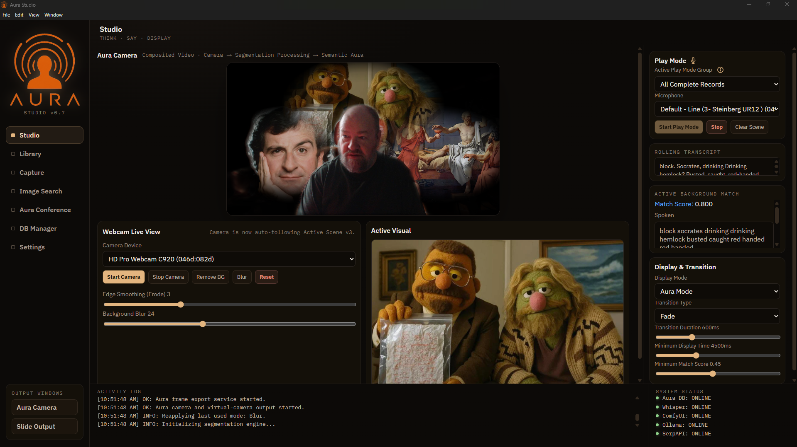
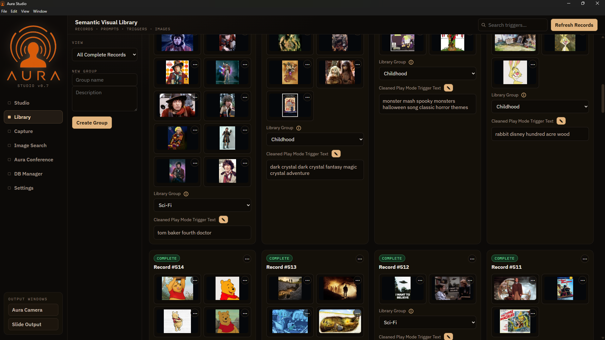

<p align="center">
  
</p>

<h1 align="center">Aura</h1>

<p align="center">
  <strong>A local-first AI virtual camera that turns live speech into matching backgrounds.</strong>
</p>

<p align="center">
  <a href="https://github.com/JeremiahBarkman/Aura/actions/workflows/ci.yml">
    
  </a>
</p>

<p align="center">
  
</p>

<p align="center">
  <em>Studio. Speech arrives in the rolling transcript, matches a library record at
  0.800, and the composited frame is already on its way to the virtual camera.</em>
</p>

Aura listens to what you are saying, finds or generates an image that matches
it, and composites that image behind you as a real webcam device that Zoom,
Teams, OBS and anything else can select. Transcription, matching and rendering
all run on your own machine.

---

## How it works

Aura has two modes that form a loop:

**Record** — you capture a short piece of speech. Whisper transcribes it
locally, Ollama turns the transcript into a summary, an image prompt and a set
of trigger phrases, and ComfyUI generates the background. The result is stored
in a local SQLite library.

**Play** — Aura transcribes your speech continuously and matches it against the
trigger phrases in that library, using keyword overlap and Ollama embeddings for
semantic matching. Matching images are composited behind you live, with your
background segmented out, and the composed frames are published to the virtual
camera device.

`ARCHITECTURE.md` describes the full execution flow, module by module.

<p align="center">
  
</p>

<p align="center">
  <em>The library. Every record keeps its images, a group it belongs to, and the
  cleaned trigger text that Play Mode matches your speech against.</em>
</p>

---

## Platform support

Aura is Windows-first. Windows is the only platform where every feature works.

| Area | Windows | Linux |
| --- | --- | --- |
| Backend, database, Studio, Play Mode, Slide Output | works | works |
| Segmentation (PaddleSeg / PsySeg) | works | works |
| ComfyUI / Ollama / Whisper integration | works | works |
| **Virtual camera device** | works | **not implemented** |
| Prerequisites wizard | works | not ported |

macOS is not supported.

---

## Requirements

Aura orchestrates several external programs rather than bundling them. It talks
to each over local HTTP, so they stay independently installable and updatable.

**Required**

- **Node.js** 22.12 or newer — the floor comes from the `electron`
  devDependency; `better-sqlite3` itself supports 20.x and up
- **Ollama** — text generation and embeddings. Pull a text model plus
  `nomic-embed-text` for semantic matching.
- **Python 3** with the speech service venv — a Flask app wrapping
  `faster_whisper`, listening on `127.0.0.1:8765`
- **FFmpeg** — audio handling

**Optional**

- **ComfyUI** — image generation. Without it, Record Mode cannot generate new
  backgrounds, but an imported library still plays.
- **Visual Studio** with the C++ workload — only needed to rebuild the native
  virtual-camera components. Prebuilt binaries are committed (see below).
- **SerpAPI key** — image search import
- **PsySeg SDK license** — the higher-quality commercial segmentation engine.
  Aura defaults to the bundled PaddleSeg model instead, so this is never
  required.

On Windows, the wizard in `installer/prerequisites/` installs and configures
most of the above for you. Run `Install Aura Prerequisites.bat` and work down
the list.

---

## Running from source

```bash
git clone https://github.com/JeremiahBarkman/Aura.git
cd Aura
npm install
```

Then create your configuration:

```bash
cp .env.example .env
```

Edit `.env` and set the paths for your machine — mainly `COMFYUI_*` and
`SPEECH_*`. Every value has a comment explaining it, and the AI service URLs
already default to the standard local ports.

On Windows, `scripts/setup-dev.ps1` creates the runtime data folders and checks
that Node is on your PATH:

```powershell
powershell -ExecutionPolicy Bypass -File scripts/setup-dev.ps1
```

### The two ways to run it

```bash
npm start        # backend only  -> http://localhost:5150
npm run electron # the full app
```

`npm start` runs just the Express + SQLite backend. There is no Electron shell,
no virtual camera and no supervised speech or ComfyUI process, which makes it
the fast way to iterate on web, API and database code.

`npm run electron` runs the real thing: the Electron shell spawns and supervises
the backend, the speech service, ComfyUI, and — on Windows, on demand — the two
native virtual-camera processes.

### Building the installer

```bash
npm run dist
```

This runs the documentation-sync check, stages the native binaries and the Node
runtime into `native/runtime/`, then builds an NSIS installer into `dist/`.
`INSTALLER.md` covers packaging and deployment in full.

---

## Ports and services

| Port | Service |
| --- | --- |
| `5150` | Aura backend (Express) — the main window loads this |
| `8188` | ComfyUI |
| `8765` | Speech service (faster-whisper) |
| `5151` | Frame bridge, TCP, loopback only |

All of these are bound to localhost.

---

## Configuration and your data

In a checkout, configuration comes from `.env` in the repository root and
runtime data is written to `data/`. Both are gitignored — `data/` holds your
SQLite database, your image library and recorded audio, and none of it belongs
in version control.

In a packaged install, Aura relocates both to a per-user directory:
`%APPDATA%\aura\` on Windows, `~/.config/Aura/` on Linux. Edit the `.env`
*there*, not the one inside the app — the bundled copy is overwritten on every
update, while yours is left alone.

Application settings that the UI owns live in `data/config/aura-config.json`,
behind a strict key allowlist in `src/config/auraConfig.js`.

---

## Segmentation engines

Aura ships two interchangeable background-segmentation providers, selected in
Settings:

- **PaddleSeg** (default) — ONNX PP-HumanSeg via `onnxruntime-web`, WebGPU with
  a WASM fallback. The model is bundled under `public/models/paddleseg/`
  (Apache-2.0) and needs no credentials, so a fresh clone has a working camera.
- **PsySeg** — the commercial Personify SDK. Higher quality, but it requires a
  paid license and renders black frames without one.

An unrecognized engine value falls back to PaddleSeg rather than leaving you
with no camera.

---

## About the committed native binaries

`native/runtime/` contains three prebuilt, **unsigned** Windows binaries:
`AuraFrameBridge.exe`, `VCamSample.exe` and `VCamSampleSource.dll`.

They are committed deliberately, so that cloning the repository gives you a
working virtual camera without installing Visual Studio. They are also
reproducible: the frame bridge builds from `native/AuraFrameBridge/`, and the
camera host builds from the vendored `native/external/VCamSample/` — whose
upstream commit, license and complete Aura diff are documented in
`native/external/VENDORED.md`. If you would rather not trust a committed
binary, build both yourself and run `npm run stage` to restage them.

Being unsigned, Windows will show "Windows protected your PC" on first run of
the installer. That is expected.

---

## Repository layout

```
electron-main.js          Process orchestrator. No application logic.
src/                      Backend: conference, db, image, import, llm,
                          play, record, speech, text, web
public/                   Renderer: UI, segmentation, rendering, output
services/speech/          Local Whisper HTTP service
native/                   Virtual camera: frame bridge, vendored VCamSample,
                          staged runtime binaries
comfy/workflows/          ComfyUI graph templates
installer/                Prerequisites wizard and shipped documentation
scripts/                  Build, staging and setup scripts
docs/                     User-facing documentation
```

---

## Documentation

| Document | Contents |
| --- | --- |
| `ARCHITECTURE.md` | System architecture and execution flow |
| `VIRTUAL_CAMERA.md` | Native virtual-camera architecture |
| `TRANSLATION.md` | Universal translation subsystem |
| `INSTALLER.md` | Packaging and deployment |
| `CLAUDE.md` | Engineering conventions for this repository |
| `docs/Aura Documentation v0.7/` | User guide, install guide, licensing report |

---

## License

Aura is released under the MIT License — see `LICENSE`.

Third-party components keep their own licenses. The bundled PP-HumanSeg model is
Apache-2.0 (`public/models/paddleseg/LICENSE`) and the vendored VCamSample is
MIT, Copyright (c) 2024-2026 Simon Mourier
(`native/external/VCamSample/LICENSE`).

Note that MIT covers Aura's own source. It does not grant rights to the external
services Aura integrates with: the **PsySeg SDK** is proprietary and gated by a
paid agreement with Personify Inc., and **SerpAPI** is a paid service under its
own terms. Neither is redistributed here. A full component-by-component
inventory is in `docs/Aura Documentation v0.7/Aura Third-Party Licensing
Report.md`.
